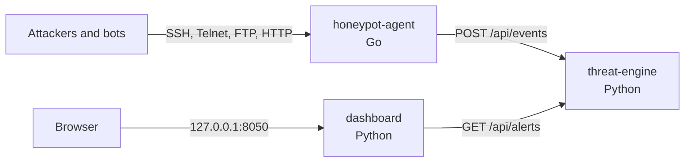

# Honeypot System

> **Work in Progress:** Project is under development.

A honeypot that impersonates a cheap ARM-based home router on SSH, Telnet, FTP and HTTP. It lets attackers and bots log in, records everything they do, and turns the activity into real-time alerts on a web dashboard.

The system has three parts, all running in Docker:

- **honeypot-agent** (Go) runs the fake services.
- **threat-engine** (Python) analyzes events and raises alerts.
- **dashboard** (Python) displays the alerts.

## How it works



- **honeypot-agent:**
  - Four fake services with one consistent persona, a router called `gateway` (Buildroot firmware, BusyBox 1.30.1): SSH (Dropbear 2019.78), Telnet (BusyBox telnetd), FTP (vsftpd 3.0.3) and HTTP (lighttpd 1.4.53 with a login page). Each answers like the real server, down to its replies to malformed requests, so scanners that fingerprint banners and replies see a real router.
  - SSH starts the shell the way Dropbear does: interactive with a terminal, a shell without prompt or echo that reads commands from its input without one (like most bots), or `sh -c` for a single command.
  - FTP lets the default accounts and `anonymous` log in and browse (`anonymous` is locked in an empty directory). Uploads, passive mode and connections to any address other than the client's are refused with vsftpd's own replies, so the server can never be used for an FTP bounce.
  - After login, attackers get a fake shell with an in-memory filesystem, a Go port of BusyBox's `ash`: variables and expansions, redirections, pipes, `if` / `for` / `while` / `case`, functions, commands typed over several lines, background jobs (`&`), and the text tools bots use (`grep`, `sed`, `awk`, `wc`, `cut`...). It passes the checks Mirai-style bots run, so they go on to reveal their malware URL. Nothing is ever executed or downloaded.
  - The router looks the same from every angle: `ps` matches `/proc/<pid>`, `free`, `df` and `uptime` match `/proc`, `/proc/sys` accepts changes with the checks of the Linux 4.14 kernel, and `ls` prints colored columns on a terminal but one name per line into a pipe.
  - `wget`, `tftp` and `ftpget` print what BusyBox prints, then fail as if the router's way out were blocked. The URL is logged in `extracted_url`.
  - The filesystem holds decoy secrets (honeytokens): the Wi-Fi password in `/etc/hostapd.conf` and the PPPoE account in `/etc/ppp/chap-secrets`. They exist nowhere else, so a later login with one of them proves the sender had read them, even from another IP.
  - All of this was compared byte for byte with the real programs: over 400 shell lines and SSH sessions with BusyBox 1.30.1, about 280 FTP commands with vsftpd 3.0.3.
  - Every action becomes a JSON event with a random `event_id`, written to stdout and sent in batches of at most 200 to the threat engine. If the threat engine is down, up to 5000 events wait in memory; a batch sent again keeps its IDs, so it is stored only once.
  - Limits keep one attacker from burying the others: 200 connections per service and 10 per IP (at most 10 new ones per second), answers paced 200 to 300 ms apart (about 40 events per second per IP, unnoticeable for anyone waiting for each answer), and at most 1000 commands per session.
  - On shutdown it stops accepting connections, ends the open sessions and delivers its last events, usually within a second.
- **threat-engine:**
  - Receives the events (`POST /api/events`, protected by a token) and evaluates each one in real time. It flags successful logins, brute force, download attempts, dangerous commands and malicious HTTP paths, with severities from LOW to CRITICAL.
  - Stores events and alerts in a SQLite database (`/data/honeypot.db`, on the `engine-data` volume). Each batch is saved in one transaction, all or nothing; if the database is busy or the disk is full, the agent gets a 503, keeps the batch and sends it again. Every event is also appended to a journal (`/data/received_events.jsonl`), exactly as received, so the database can be rebuilt from it.
  - Everything the dashboard shows is read from the database: statistics over all events and alerts, the latest 500 alerts, the latest 2000 sessions and the full history of one attacker. Only the last 10 minutes of failed logins (for brute force) are kept in memory, so a restart takes well under a second and memory stays small. Each session's summary keeps its first 50 commands, passwords, usernames and download URLs; its stages and login count cover all of its events.
  - `main.py` runs an offline analysis that produces per-session summaries and a kill-chain funnel.
- **dashboard:**
  - A live view of the alerts: summary cards, charts, top attacking IPs and an alert table refreshed every 5 seconds.
  - It reads everything from the threat engine's API.

## Quick start

You need Git and Docker: Docker Desktop on Windows or macOS, or Docker Engine with the Compose plugin on Linux.

```bash
git clone https://github.com/Andrei-exe/Honeypot-System.git
cd Honeypot-System
cp .env.example .env        # Windows (cmd): copy .env.example .env
```

Generate a token with the command below, and put it in `.env` as `AGENT_TOKEN=<value>`:

```bash
python -c "import secrets; print(secrets.token_hex(16))"
```

Then start everything:

```bash
docker compose up -d --build
```

Open the dashboard at <http://127.0.0.1:8050> and attack the honeypot from another terminal:

```bash
ssh root@127.0.0.1 -p 2222      # password: root
ftp                             # then: open 127.0.0.1 2121
telnet 127.0.0.1 2323           # or PuTTY, connection type Telnet
```

The fake login page is at <http://127.0.0.1:8080>. Alerts show up within about 5 seconds. By default everything listens only on `127.0.0.1`.

## Configuration

All settings live in `.env`; see `.env.example` for every option. Apply changes with `docker compose up -d`.

| Variable | Default | Description |
|---|---|---|
| `AGENT_TOKEN` | empty | Shared secret between the agent and the threat engine |
| `BIND_IP` | `127.0.0.1` | Set to `0.0.0.0` to expose the honeypot |
| `PUBLIC_IP` | empty | The server's public IP address, shown in an SSH session's `SSH_CONNECTION` like Dropbear does; empty leaves `SSH_CONNECTION` and `SSH_CLIENT` out |
| `FTP_PORT`, `SSH_PORT`, `TELNET_PORT`, `HTTP_PORT` | `2121`, `2222`, `2323`, `8080` | Honeypot ports on the host |
| `DASHBOARD_PORT` | `8050` | Dashboard port, always bound to `127.0.0.1` |
| `INCLUDE_INTERNAL` | `true` | Also alert on private IPs (needed for local testing) |

## Useful commands

| Task | Command |
|---|---|
| Start, or rebuild after code changes | `docker compose up -d --build` |
| Stop (data is kept) | `docker compose down` |
| Live events from the agent | `docker logs -f honeypot-agent` |
| Live alerts | `docker logs -f threat-engine` |
| Offline analysis | `docker compose run --rm threat-engine python main.py --input /data/received_events.jsonl --include-internal` |
| Resource usage | `docker stats --no-stream` |
| Copy of the database, to open in a SQLite viewer | see below |

To look at the data (for example in DB Browser for SQLite or a SQLite viewer extension for VS Code), take a consistent copy with SQLite's backup API and open the copy, never the live file: the database runs in WAL mode, so a plain copy of `honeypot.db` taken while the threat engine writes can be incomplete. This writes `honeypot-copy.db` in the current folder (ignored by git, like every `*.db`), as a single file; run it again for a fresh copy:

```bash
docker exec threat-engine python -c "import sqlite3; d = sqlite3.connect('/data/copy.db'); sqlite3.connect('/data/honeypot.db').backup(d); d.execute('PRAGMA journal_mode=DELETE'); d.close()" && docker cp threat-engine:/data/copy.db honeypot-copy.db
```

In Windows PowerShell 5, use `;` instead of `&&`.

To rebuild the database from the journal (after a change to the tables, or if the database is damaged), stop the threat engine first. Every event goes through the same rules again, so the alerts come out the same; lines the journal holds twice (a batch the agent sent again) are skipped. The old database is not deleted, it is renamed to `honeypot.db.old-<date>`:

```bash
docker compose stop threat-engine
docker compose run --rm threat-engine python rebuild_db.py
docker compose start threat-engine
```

The offline analysis runs with the threat engine's 512 MB limit and needs about 6 times the size of `received_events.jsonl` in memory. If it gets killed (exit code 137) on a large file, run it with a higher limit:

```bash
docker run --rm -m 2g --read-only --cap-drop ALL --security-opt no-new-privileges -v honeypot-system_engine-data:/data honeypot-system-threat-engine python main.py --input /data/received_events.jsonl --output /data/filtered_alerts.json --include-internal
```

Avoid `docker compose down -v`. It deletes the SSH host key, which changes the server fingerprint.

The Compose project name is fixed to `honeypot-system` (`name:` in `docker-compose.yml`), so the volume and image names above (`honeypot-system_agent-data`, `honeypot-system_engine-data`, `honeypot-system-threat-engine`) are the same no matter which folder the repository is cloned into. Without it, Compose would name them after the folder, and a clone in a different folder would start with empty volumes and a new SSH host key.

## Security

- **What attackers can reach:** only the agent. It runs as a non-root user in a distroless image that has no shell.
- **The threat engine** has no published ports and no internet access. It sits only on an internal Docker network.
- **The dashboard** has no authentication, so it is only ever bound to `127.0.0.1`.
- **Built-in limits:**
  - connections per service and per IP;
  - timeouts copied from the real servers, which sending a byte now and then cannot stretch: 60 seconds for the whole Telnet login (BusyBox), 300 seconds from connecting to logging in over SSH (Dropbear), 5 seconds for an idle HTTP keep-alive connection and 100 requests per connection (lighttpd), plus 60 seconds for each shell command line;
  - limits on line length and number of commands;
  - size limits copied from the real servers: 8 KB of HTTP request headers (lighttpd), 9000 bytes for an SSH command and 100 bytes for an SSH username or password (Dropbear). No single request can turn into a huge event;
  - a bug that some attacker input triggers ends only that attacker's session: the agent recovers, logs it and keeps serving everyone else;
  - 256 KB of fake disk space per shell session. Past that, writes fail the way they do on a full disk, with BusyBox's own error messages, and `df` shows the disk full. One session can no longer fill the agent's memory;
  - 64 KB for a session's shell variables (and as much again for its shell functions), and caps on what one command line can make the shell do (nesting, number of commands, pattern matching and arithmetic work), so endless loops, `sh -c` / `eval` loops and fork bombs stop at once instead of keeping a CPU busy. A function that calls itself forever crashes the shell the way it crashes the real one (exit code 139).
- **No escape routes:**
  - FTP never opens data connections;
  - SSH allows no port forwarding;
  - attacker downloads are logged but never performed.
- **Read-only containers:** every container's filesystem is read-only (`read_only: true`). The only writable places are the named volumes mounted at `/data` (the SSH host key, and the threat engine's events and alerts), so a compromised process cannot drop files or modify code.
- **No Linux capabilities:** every container drops all capabilities (`cap_drop: [ALL]`). The services listen on ports above 1024 and Docker maps them to 21/22/23/80, so they need none. Even a process that became root inside a container could not open raw sockets, change file ownership or bypass file permissions.
- **No outbound connections (on the server):** the agent and the dashboard answer whoever connects to them, but cannot open new connections themselves: not to the internet, not to other networks, not to the host. This is enforced by host firewall rules (`deploy/egress-firewall.sh`, see [Deploying to a server](#deploying-to-a-server)), because Docker can only cut a network off completely, which would also remove its published ports. They also get no DNS for internet names (`dns: 127.0.0.1`), which would otherwise be a hidden way out. A healthy honeypot never connects out, so every blocked attempt is logged by the kernel with the prefix `honeypot-egress:`.
- **No privilege escalation:** every container runs with `no-new-privileges`, so setuid programs such as `su` or `passwd` (present in the Python images) start with the caller's user instead of root.
- **Resource limits:** each container has a memory, CPU and process limit, so an attack or a bug cannot take down the whole server:

  | Container | Memory | CPU | Processes/threads |
  |---|---|---|---|
  | honeypot-agent | 256 MB (Go heap soft limit 200 MiB) | 1 core | 128 |
  | threat-engine | 512 MB | 1 core | 64 |
  | dashboard | 128 MB | 0.5 core | 64 |

  In a local load test (see [Load testing](#load-testing)), the agent held 800 simultaneous sessions with about 30 MB of memory, and handled about 160 SSH login attempts per second with a quarter of one core (a wrong password is answered after about 300 ms, as Dropbear does). A process that goes over its memory limit is killed and the container restarts.
- **Automatic restart:** every container comes back after a crash or a server reboot (`restart: unless-stopped`). A container you stop yourself stays stopped.
- **Log rotation:** Docker keeps at most 100 MB of logs for the agent (5 files of 20 MB) and 30 MB for each Python container (3 files of 10 MB), so a busy server cannot fill its disk. Older lines are deleted, which means `docker logs honeypot-agent` shows only recent events. The full history is kept by the threat engine, in its database and in the `received_events.jsonl` journal.

## Deploying to a server

1. Move the server's real SSH daemon to another port, for example 52222.
2. Install Docker: `curl -fsSL https://get.docker.com | sh`.
3. Clone the repository and create `.env` with:
   - a long `AGENT_TOKEN`;
   - `BIND_IP=0.0.0.0`;
   - `PUBLIC_IP=` the server's public IP address;
   - `FTP_PORT=21`, `SSH_PORT=22`, `TELNET_PORT=23`, `HTTP_PORT=80`.
4. Run `docker compose up -d --build`.
5. Block outbound connections from the containers. The rules are applied now and again after every reboot or Docker restart:

   ```bash
   sudo install -m 755 deploy/egress-firewall.sh /usr/local/sbin/honeypot-egress-firewall
   sudo cp deploy/honeypot-egress.service /etc/systemd/system/
   sudo systemctl daemon-reload
   sudo systemctl enable --now honeypot-egress
   ```

   Check that they are active: `sudo iptables -S DOCKER-USER | grep br-honeynet` should print two rules. Blocked attempts show up in `sudo journalctl -k | grep honeypot-egress`. To turn them off: `sudo systemctl stop honeypot-egress`.
6. Open the dashboard through an SSH tunnel: `ssh -p 52222 -L 8050:127.0.0.1:8050 user@server`, then browse to <http://127.0.0.1:8050>.

Docker's published ports bypass firewalls such as `ufw`, so keep the dashboard on `127.0.0.1`. The egress rules work alongside `ufw`; after enabling or reloading `ufw`, run the check from step 5 again. The rules cover IPv4 only, so leave IPv6 disabled on the Docker networks (the default).

## Development without Docker

Stop the matching containers first, otherwise the ports clash.

```bash
cd honeypot-agent && go run .                    # Go 1.27.4+, events printed to stdout
cd threat-engine && pip install -r requirements.txt && python receiver.py   # port 8000
cd dashboard && pip install -r requirements.txt && python app.py            # port 8050
```

Run the agent's tests with `go test ./...` in `honeypot-agent/` (about 10 seconds). Besides unit tests, they run real sessions against each fake service on a local port and check what an attacker sees, the safety rules (FTP never opens a data connection, SSH refuses port forwarding, `wget` downloads nothing) and that every logged event matches `shared/event-schema.json`. Run `python main.py` in `threat-engine/` to analyze the sample data in `shared/mock_events.jsonl`.

## Load testing

`honeypot-agent/cmd/loadgen` is a small load generator for the agent. Use it only against your own setup. It never starts with a normal `docker compose up`, only when you name it.

The agent accepts at most 10 connections per IP, so the generator runs as several containers on the agent's network, each with its own IP. With the honeypot running:

```bash
docker compose up --build --scale loadgen=20 loadgen   # 20 x 10 = 200 sessions per service, the per-service maximum
docker compose rm -f loadgen                            # always remove the finished containers afterwards
```

Always remove the containers after a run. On Docker Desktop, starting a run with a different mode on top of the old containers once left them stuck until Docker was restarted.

Choose what it does with environment variables:

| Variable | Default | Description |
|---|---|---|
| `LOADGEN_MODE` | `hold` | `hold` logs in on every service and keeps the sessions open; `fill` does the same, but every SSH and Telnet session also fills its fake disk and variables to their limits (the most memory the agent can need); `brute` runs SSH logins with a wrong password in a loop; `http` sends a mix of web attacks in a loop |
| `LOADGEN_SECONDS` | `25` | How long to hold the sessions or run the loops |

For example, `LOADGEN_MODE=http docker compose up --scale loadgen=20 loadgen` on Linux or macOS. On Windows, set the variable first: `set LOADGEN_MODE=http` (cmd) or `$env:LOADGEN_MODE="http"` (PowerShell).

Each copy prints one line. In `hold` and `fill` mode, for example `hold 25s: ssh ok=10 closed=0 failed=0 | telnet ok=10 closed=0 failed=0 | ...`:

- `ok`: the session stayed open until the end;
- `closed`: the agent closed it early (a timeout);
- `failed`: the generator could not connect or log in (for example, a connection limit was hit).

In `http` mode, each loop acts as one bot after another. A bot opens a connection, sends 1 to 5 requests of one kind and leaves. The kinds are:

- logins with a form, with the field names of different targets: `username`/`password` (this router), `user`/`pass`, `log`/`pwd` (WordPress);
- Basic Auth;
- passwords in the URL (`/login.cgi?user=...&pwd=...`);
- scanner and exploit paths (`/.env`, path traversal, SQL injection, a Log4Shell probe, command injection).

User names, passwords and user agents vary. The payloads are harmless: every address in them is in `203.0.113.0/24`, a range reserved for documentation. The generator also checks each answer against what the agent should send (200, 401 or the 404 page). The line looks like `http 25s: requests=640 (26/s) logins=480 unexpected=0 errors=100`. About 26 requests per second per copy is the expected rate: each copy has 10 connections, the agent takes 200 to 300 ms per answer, and a connection keeps its place for at least one second. The fields:

- `requests`: answered requests. The agent logs each one, so the sum over all copies equals the number of HTTP events it wrote;
- `logins`: the answered requests that carried a password (`login_attempt` events);
- `unexpected`: answers with a different status than the agent should send. It must be 0; otherwise the first one is printed;
- `errors`: requests without an answer, with the first error printed. About 4 per second per copy is normal, as `EOF` or `connection reset by peer`. A bot that comes back less than a second after its previous connection opened finds that place still taken, so the agent refuses it. The bot then waits a second before it tries again.

Watch the agent with `docker stats` in another terminal. The generated sessions are recorded like real attacks, from `172.x` addresses, so they show up on the dashboard. Do not run the generator on a production sensor.

## GeoIP (optional: country/city on the map)

The threat engine can tag each alert with the attacker's country and city, which
powers the map on the dashboard. This needs a GeoIP database **file**
(`GeoLite2-City.mmdb`). The file is **not** in the repository because its license
forbids redistribution, so you download it yourself.

Without it, everything still works — the engine just prints `fara GeoIP` at startup
and alerts have no country (the map stays empty).

To enable it:

1. Create a free account at <https://www.maxmind.com> and download **GeoLite2 City**
   (the `.mmdb` format, delivered inside a `.tar.gz`).
2. Extract it and copy the file into `threat-engine/`, next to `receiver.py`:
   ```bash
   cp ~/Downloads/GeoLite2-City.mmdb threat-engine/
   ```
3. Restart `receiver.py`. If the `fara GeoIP` line is gone, it works.

The filename must be exactly `GeoLite2-City.mmdb`, or set `GEOIP_DB=/path/to/file.mmdb`.
In Docker, mount the file into the threat-engine container and point `GEOIP_DB` at it.

**No-signup alternative:** DB-IP's [IP-to-City Lite](https://db-ip.com/db/download/ip-to-city-lite)
is free, needs no account (only attribution), and is the same MaxMind-DB format, so
`geo.py` reads it as-is. Download it, then either rename it to `GeoLite2-City.mmdb` or
set `GEOIP_DB` to its path.

**Never commit the `.mmdb` file** — it is licensed and large. Keep it in `.gitignore`.

## Repository layout

```
honeypot-agent/   Go: fake services, fake shell, event shipper (cmd/loadgen: load generator for testing)
threat-engine/    Python: event API, detection rules, offline analysis
dashboard/        Python: web dashboard
shared/           event-schema.json (event contract) and sample data
deploy/           server setup: egress firewall script and its systemd unit
```

## Roadmap

- Multiple sensors: node IDs and ports from the environment.
- Malware sample collection with SHA-256 hashing.
- Tarpit.
- Deployment on a public server.
