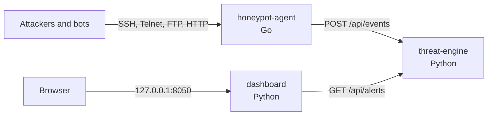

# Honeypot System

> **Work in Progress:** Project is under development.

A distributed honeypot that impersonates a cheap ARM-based home router on SSH, Telnet, FTP and HTTP. It lets attackers and bots log in, records everything they do, and turns the activity into real-time alerts on a web dashboard.

The system has three parts, all running in Docker:

- **honeypot-agent** (Go) runs the fake services.
- **threat-engine** (Python) analyzes events and raises alerts.
- **dashboard** (Python) displays the alerts.

## How it works



- **honeypot-agent:**
  - Four fake services with one consistent persona, a router called `gateway`: SSH (Dropbear), Telnet (BusyBox), FTP (vsFTPd) and HTTP (a lighttpd login page).
  - After login, attackers get a fake shell with an in-memory filesystem. It passes the checks Mirai-style bots run, so they go on to reveal their malware URL. Nothing is ever executed or downloaded.
  - Every action becomes a JSON event. Events are sent in batches to the threat engine and also written to stdout.
- **threat-engine:**
  - Receives the events (`POST /api/events`, protected by a token) and evaluates each one in real time. It flags successful logins, brute force, download attempts, dangerous commands and malicious HTTP paths, with severities from LOW to CRITICAL.
  - `main.py` runs an offline analysis that produces per-session summaries and a kill-chain funnel.
- **dashboard:**
  - A live view of the alerts: summary cards, charts, top attacking IPs and an alert table refreshed every 5 seconds.
  - It reads everything from the threat engine's API.

## Quick start

You need Git and Docker: Docker Desktop on Windows or macOS, or Docker Engine with the Compose plugin on Linux.

```bash
git clone https://github.com/Andrei-exe/Honeypot-System.git
cd Honeypot-System
cp .env.example .env        # Windows (cmd): copy .env.example .env
```

Generate a token with the command below, and put it in `.env` as `AGENT_TOKEN=<value>`:

```bash
python -c "import secrets; print(secrets.token_hex(16))"
```

Then start everything:

```bash
docker compose up -d --build
```

Open the dashboard at <http://127.0.0.1:8050> and attack the honeypot from another terminal:

```bash
ssh root@127.0.0.1 -p 2222      # password: root
ftp                             # then: open 127.0.0.1 2121
telnet 127.0.0.1 2323           # or PuTTY, connection type Telnet
```

The fake login page is at <http://127.0.0.1:8080>. Alerts show up within about 5 seconds. By default everything listens only on `127.0.0.1`.

## Configuration

All settings live in `.env`; see `.env.example` for every option. Apply changes with `docker compose up -d`.

| Variable | Default | Description |
|---|---|---|
| `AGENT_TOKEN` | empty | Shared secret between the agent and the threat engine |
| `BIND_IP` | `127.0.0.1` | Set to `0.0.0.0` to expose the honeypot |
| `FTP_PORT`, `SSH_PORT`, `TELNET_PORT`, `HTTP_PORT` | `2121`, `2222`, `2323`, `8080` | Honeypot ports on the host |
| `DASHBOARD_PORT` | `8050` | Dashboard port, always bound to `127.0.0.1` |
| `INCLUDE_INTERNAL` | `true` | Also alert on private IPs (needed for local testing) |

## Useful commands

| Task | Command |
|---|---|
| Start, or rebuild after code changes | `docker compose up -d --build` |
| Stop (data is kept) | `docker compose down` |
| Live events from the agent | `docker logs -f honeypot-agent` |
| Live alerts | `docker logs -f threat-engine` |
| Offline analysis | `docker compose run --rm threat-engine python main.py --input /data/received_events.jsonl --include-internal` |

Avoid `docker compose down -v`. It deletes the SSH host key, which changes the server fingerprint.

## Security

- **What attackers can reach:** only the agent. It runs as a non-root user in a distroless image that has no shell.
- **The threat engine** has no published ports and no internet access. It sits only on an internal Docker network.
- **The dashboard** has no authentication, so it is only ever bound to `127.0.0.1`.
- **Built-in limits:**
  - connections per service and per IP;
  - an idle timeout;
  - limits on line length and number of commands.
- **No escape routes:**
  - FTP never opens data connections;
  - SSH allows no port forwarding;
  - attacker downloads are logged but never performed.
- **Read-only containers:** every container's filesystem is read-only (`read_only: true`). The only writable places are the named volumes mounted at `/data` (the SSH host key, and the threat engine's events and alerts), so a compromised process cannot drop files or modify code.
- **No Linux capabilities:** every container drops all capabilities (`cap_drop: [ALL]`). The services listen on ports above 1024 and Docker maps them to 21/22/23/80, so they need none. Even a process that became root inside a container could not open raw sockets, change file ownership or bypass file permissions.
- **No privilege escalation:** every container runs with `no-new-privileges`, so setuid programs such as `su` or `passwd` (present in the Python images) start with the caller's user instead of root.
- **Automatic restart:** every container comes back after a crash or a server reboot (`restart: unless-stopped`). A container you stop yourself stays stopped.
- **Log rotation:** Docker keeps at most 100 MB of logs for the agent (5 files of 20 MB) and 30 MB for each Python container (3 files of 10 MB), so a busy server cannot fill its disk. Older lines are deleted, which means `docker logs honeypot-agent` shows only recent events. The full history is kept by the threat engine in `received_events.jsonl`.

## Deploying to a server

1. Move the server's real SSH daemon to another port, for example 52222.
2. Install Docker: `curl -fsSL https://get.docker.com | sh`.
3. Clone the repository and create `.env` with:
   - a long `AGENT_TOKEN`;
   - `BIND_IP=0.0.0.0`;
   - `FTP_PORT=21`, `SSH_PORT=22`, `TELNET_PORT=23`, `HTTP_PORT=80`.
4. Run `docker compose up -d --build`.
5. Open the dashboard through an SSH tunnel: `ssh -p 52222 -L 8050:127.0.0.1:8050 user@server`, then browse to <http://127.0.0.1:8050>.

Docker's published ports bypass firewalls such as `ufw`, so keep the dashboard on `127.0.0.1`.

## Development without Docker

Stop the matching containers first, otherwise the ports clash.

```bash
cd honeypot-agent && go run .                    # Go 1.27.2+, events printed to stdout
cd threat-engine && pip install -r requirements.txt && python receiver.py   # port 8000
cd dashboard && pip install -r requirements.txt && python app.py            # port 8050
```

Run the agent's tests with `go test ./...`. Run `python main.py` in `threat-engine/` to analyze the sample data in `shared/mock_events.jsonl`.

## Repository layout

```
honeypot-agent/   Go: fake services, fake shell, event shipper
threat-engine/    Python: event API, detection rules, offline analysis
dashboard/        Python: web dashboard
shared/           event-schema.json (event contract) and sample data
```

## Roadmap

- Container hardening: read-only filesystems, dropped capabilities, resource limits.
- Graceful shutdown and multiple sensors.
- CI with GitHub Actions.
- Malware sample collection with SHA-256 hashing.
- Tarpit.
- Deployment on a public server.